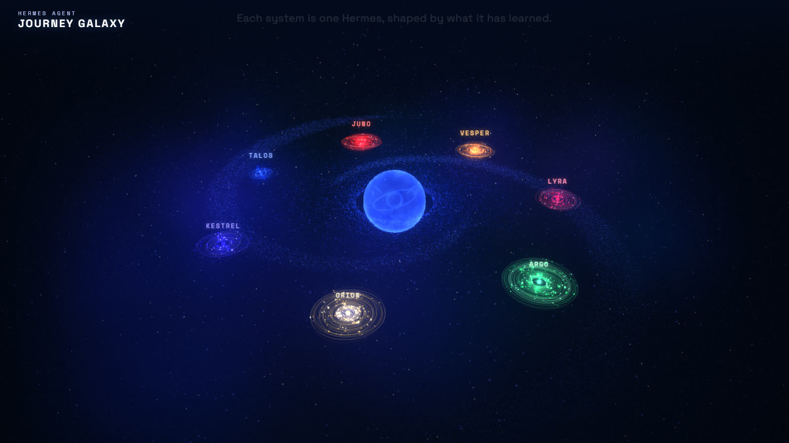
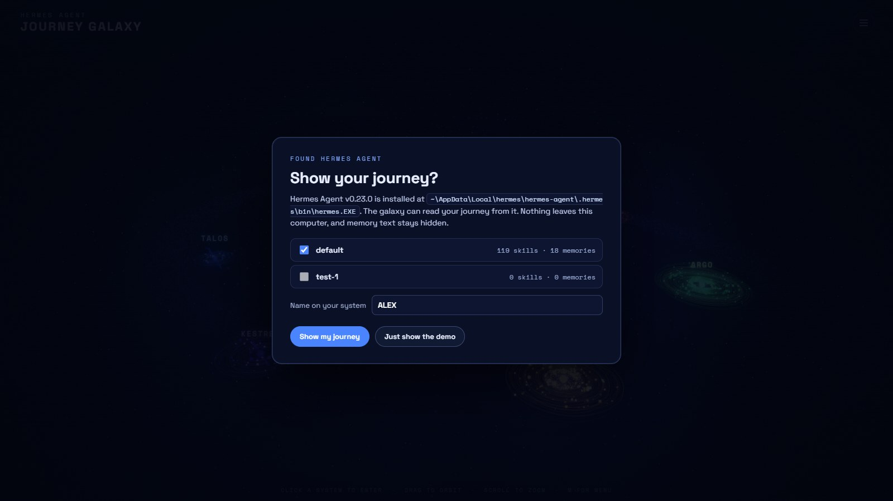
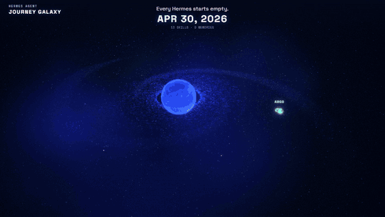

# Hermes Journey Galaxy

See what your Hermes Agent has learned. Every skill and memory becomes a planet orbiting your own star, placed in the order Hermes learned it. Add friends' journeys and you get a galaxy you can fly through and compare.



It runs on your own computer. If Hermes Agent is installed, the galaxy finds it on first launch and asks before reading anything.

## Quick start

You need Python 3.8 or newer. You don't need to install anything else.

```bash
git clone https://github.com/<you>/hermes-journey-galaxy.git
cd hermes-journey-galaxy
python3 galaxy.py
```

On Windows, run `python galaxy.py`, or double-click `start-windows.bat`. On a Mac you can double-click `start-mac.command`.

Your browser opens to `http://127.0.0.1:8791`. If Hermes Agent is on this computer you will see this:



Click **Show my journey** and your system builds itself, starting from the first skill Hermes learned. If Hermes is not found, you get the demo galaxy and instructions for adding a journey file.

## Hand it to your agent

Paste this into Hermes, Claude Code, Codex, or any coding agent:

```text
Set up Hermes Journey Galaxy for me and show me my journey.

1. Clone https://github.com/<you>/hermes-journey-galaxy (or use the copy at <path> if it's already here) and cd into it.
2. Read AGENTS.md and follow it.
3. Check my Hermes install with: python3 galaxy.py --detect   (use `python` on Windows)
4. If it finds Hermes and a profile has skills, start it with: python3 galaxy.py --use-hermes
   If it doesn't find Hermes, start it with: python3 galaxy.py
   Run the server in the background so it keeps running.
5. Tell me the URL it prints, how many skills and memories it found per profile, and how to stop it.
Don't install packages, don't change my Hermes config, and don't print my memory text.
```

The agent needs no extra context. AGENTS.md covers the commands, the file layout, and what must stay private.

## What you are looking at

| | |
|---|---|
| **Star** | One Hermes journey (one person, or one Hermes profile). |
| **Planets** | Skills. Bigger planets are used more often. |
| **Small pale moons** | Memories. Their text stays hidden unless you ask for it. |
| **Orbit distance** | When it was learned. The oldest skills sit closest to the star. |
| **Lines** | Connections: memories link to the skills that use them, and related skills link to each other. |


When nobody is touching it, the galaxy plays a tour on its own. All journeys grow from day one together, then the camera visits each system and the stats are compared:




**Controls**

| Action | Mouse / keyboard | Touch |
|---|---|---|
| Enter a system | click its star | tap |
| Orbit the camera | drag | drag |
| Zoom | scroll | pinch |
| Inspect a skill or memory | click it | tap |
| Scrub through time | drag the timeline at the bottom | drag |
| Back to the galaxy | `← GALAXY` button | tap |
| Menu (journeys, Hermes, add files) | `M` or the ☰ button | tap ☰ |

After 25 seconds without input, the tour starts again.

## Add more journeys

You can add a journey in any of these ways:

1. **Drag and drop** a journey file onto the page.
2. **Drop files into `journeys/`**. They appear within a few seconds, without a reload.
3. **Use the menu** (`M`): *Choose files*, or turn Hermes on or off.

To make a journey file, run this on the computer where that Hermes lives:

```bash
hermes journey --json > alex-journey.json
```

The filename sets the label, so `alex-journey.json` shows up as **ALEX**. Common suffixes such as `-journey`, `.redacted` and `_combined` are dropped.

Each Hermes **profile** on your machine becomes its own system. To pick profiles, use `--profile default,work`. A multi-profile export (`"profiles": [...]`) from one person is merged into one system.

## Privacy

- Everything runs on `127.0.0.1`. The server refuses requests addressed to any other host, and it never sends data anywhere.
- **Memory text is never shown by default.** Memories appear as `Memory note 01`, `Profile note 02`, and so on. To see your own memory text locally, add `?memories=1` to the URL.
- Skill names are shown, because they are the map. If a skill name is sensitive, rename it in the JSON before sharing, or ask your agent to do it.
- `python3 galaxy.py --export team.json` writes everything in the current galaxy to one shareable file with memory text removed.

**Before you send your journey to someone,** open your file and check the skill names. Memory text is safe to leave in, because the galaxy hides it, but it is still in the file, so remove it if you would rather not send it.

## Options

```text
python3 galaxy.py [options]

  --use-hermes        use the detected Hermes install without asking
  --no-hermes         don't read from Hermes; show journey files only
  --hermes PATH       path to the hermes launcher, if it isn't found automatically
  --profile NAMES     comma-separated Hermes profiles to show (default: all with data)
  --name NAME         label for your default profile's system (default: your username)
  --journeys DIR      folder of journey files (default: ./journeys)
  --demo              show only the example galaxy
  --tv                open in TV mode: no hints or menu button, for kiosks and big screens
  --port N            port to serve on (default 8791; moves up if busy)
  --no-open           don't open a browser tab
  --detect            print what Hermes detection finds, then exit
  --export FILE       write the current galaxy to one shareable file, then exit
```

Settings you choose in the browser are saved to `.galaxy/settings.json`. Delete that folder to see the first-run card again.

URL options: `?tv` (no hints or menu), `?memories=1` (show your memory text), `?q=hi` (full resolution on 4K screens), `&msaa=4` (smoother thin lines on a strong GPU).

## How detection works

On launch, `galaxy.py` looks for a `hermes` launcher in these places, in order:

1. `$HERMES_BIN`, if you set it.
2. Your `PATH`.
3. Where the Hermes installer puts it: `~/.hermes/hermes-agent/.hermes/bin/hermes` on macOS and Linux, `%LOCALAPPDATA%\hermes\hermes-agent\.hermes\bin\hermes.exe` on Windows.
4. `~/.local/bin`, `/opt/homebrew/bin`, `/usr/local/bin`, and the agent bundled in `Hermes.app`.

It confirms the launcher is Hermes with `hermes --version`, lists profiles from `$HERMES_HOME/profiles/`, and reads each one with `hermes [-p NAME] journey --json`. It only reads. It never writes to your Hermes home.

If your install lives somewhere else, run `python3 galaxy.py --hermes /path/to/hermes`.

## Troubleshooting

| Problem | Fix |
|---|---|
| "Hermes Agent not found" | Run `hermes --version` in a terminal. If that works, pass its path with `--hermes "$(which hermes)"`. |
| My profile isn't shown | It has no skills or memories yet. Use Hermes for a while, then press **Refresh** in the menu. |
| Blank page or a "start from a terminal" card | Open the URL that `galaxy.py` prints. Browsers do not run the page straight from the file. |
| Port already in use | It moves to the next free port and prints the new URL, or use `--port 9100`. |
| It's slow on a laptop | Plug it into power. On 4K screens it renders at 1440p unless you add `?q=hi`. |
| I want the setup card again | Delete the `.galaxy/` folder and restart. |

## Repository layout

```text
galaxy.py            local server, Hermes detection, journey loading (Python standard library only)
start-windows.bat    double-click launcher (Windows)
start-mac.command    double-click launcher (macOS)
web/                 the app: plain ES modules, no build step
  index.html         page, HUD, menu, first-run card
  galaxy.js          three.js renderer and the idle tour
  app.js             loading, setup, menu, drag and drop, live reload
  palette.js         per-system colors and star types
  textures.js        procedural planet and star textures
  vendor/            three.js r160 (MIT), bundled so it works offline
  fonts/             Space Grotesk and Space Mono (SIL OFL)
journeys/            put journey files here (git-ignored)
examples/            the demo galaxy: 7 fictional journeys in `hermes journey --json` format
tests/               python3 -m unittest discover -s tests
docs/                screenshots, ARCHITECTURE.md
```

Developer notes are in [docs/ARCHITECTURE.md](docs/ARCHITECTURE.md). Guidance for coding agents is in [AGENTS.md](AGENTS.md).

## License

MIT. three.js is MIT. Space Grotesk and Space Mono are under the SIL Open Font License; the license files are in `web/vendor/` and `web/fonts/`. Hermes Agent is a project of Nous Research. This viewer is a separate community tool.
